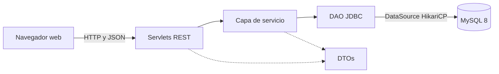
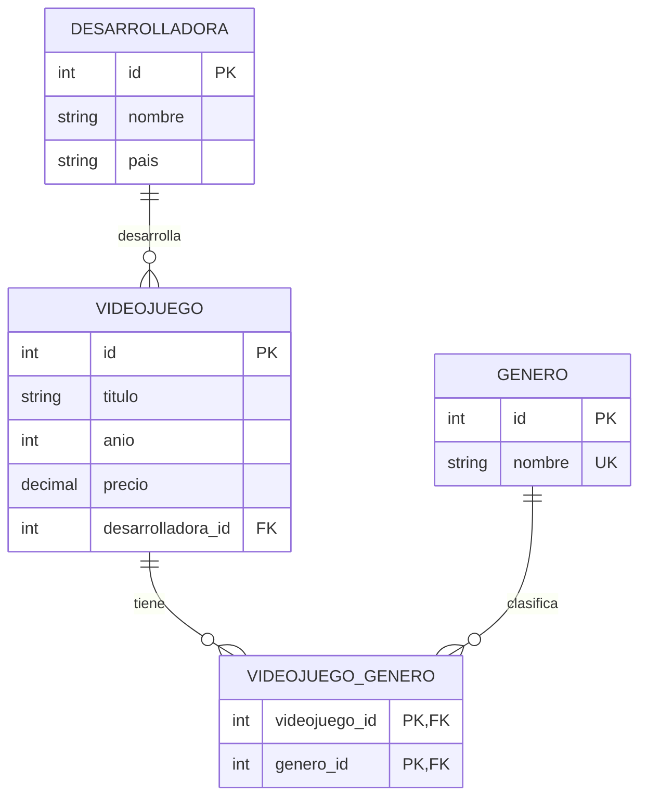
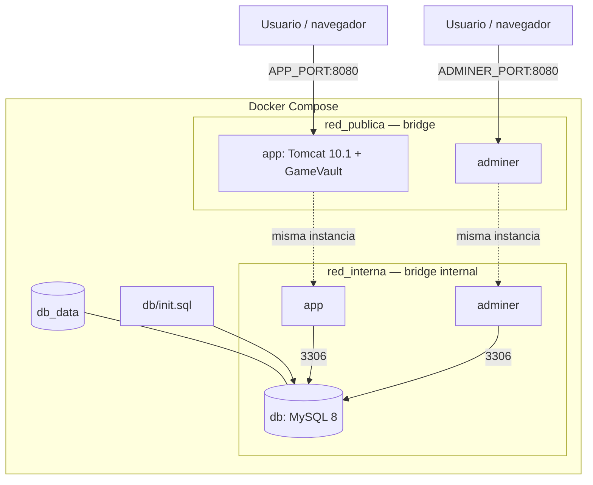

# GameVault

GameVault es una aplicación web para consultar y mantener un catálogo de videojuegos. Permite crear, editar y eliminar juegos, relacionarlos con una desarrolladora y asignarles uno o varios géneros. El proyecto está construido con Java 17, Maven, Servlets Jakarta EE 10 y Tomcat 10.1; utiliza JDBC con HikariCP para acceder a MySQL 8 y una interfaz HTML, CSS y JavaScript que consume una API REST JSON.

## Funcionalidades

- Listar, crear, editar y borrar videojuegos.
- Consultar y crear desarrolladoras, y consultar géneros.
- Validar los datos del juego: título obligatorio (máximo 100 caracteres), año desde 1970 hasta el año actual y precio no negativo.
- Asociar cada videojuego a una desarrolladora y varios géneros.
- Mostrar los errores de validación y del servidor en la interfaz.

## Arquitectura

La aplicación organiza el acceso a datos en capas: los servlets reciben y responden peticiones HTTP, los servicios aplican reglas de negocio, los DAO implementan JDBC y los DTOs sirven de intercambio entre capas. Las entidades del modelo no se exponen directamente en la API.



## Modelo de datos

El esquema se crea desde `db/init.sql`, con codificación `utf8mb4`. Una desarrolladora puede tener varios videojuegos y un videojuego puede pertenecer a varios géneros; `videojuego_genero` resuelve esta relación muchos-a-muchos. El borrado de una desarrolladora con juegos asociados está restringido; al borrar un videojuego o un género se eliminan sus asociaciones de la tabla puente.



## Despliegue con Docker Compose

### Requisitos

- Docker Engine o Docker Desktop con Docker Compose v2.
- Para ejecutar los tests localmente: JDK 17 y Maven.

### Configurar y arrancar

1. En la raíz del proyecto, crea `.env` a partir de `.env.example`.

   En PowerShell:

   ```powershell
   Copy-Item .env.example .env
   ```

   En macOS o Linux:

   ```sh
   cp .env.example .env
   ```

2. Edita `.env` y sustituye los valores de ejemplo de `DB_PASSWORD` y `MYSQL_ROOT_PASSWORD` por contraseñas propias. No publiques ni compartas el archivo `.env`.
3. Desde el directorio raíz, construye y arranca los servicios:

   ```sh
   docker compose up --build -d
   ```

   Compose espera a que el healthcheck de MySQL indique que está listo antes de iniciar la aplicación y Adminer.
4. Abre GameVault en `http://localhost:8080` y Adminer en `http://localhost:8081` (o utiliza los puertos configurados en `.env`).

Para revisar el estado de los servicios, ejecuta `docker compose ps`; para consultar sus registros, `docker compose logs -f app`. Para detener los contenedores sin borrar los datos persistidos, ejecuta `docker compose down`.

### Servicios, redes y puertos



| Servicio | Función | Puerto en el host (predeterminado) |
|---|---|---:|
| `app` | Aplicación web y API REST | `8080` |
| `adminer` | Administración de MySQL desde el navegador | `8081` |
| `db` | Base de datos MySQL 8 | No publicado |

La red `red_interna` es interna y contiene los tres servicios; `red_publica` conecta únicamente `app` y `adminer`. Solo se publican los puertos de la aplicación y Adminer. El volumen nombrado `db_data` conserva la base de datos al detener o recrear los contenedores. El script de inicialización se ejecuta al inicializar un volumen de datos vacío; los cambios posteriores a `db/init.sql` no vuelven a sembrar un volumen ya existente.

### Variables de entorno

| Variable | Uso | Valor de ejemplo |
|---|---|---|
| `DB_HOST` | Host MySQL visto desde el contenedor `app` | `db` |
| `DB_PORT` | Puerto MySQL dentro de la red Docker | `3306` |
| `DB_NAME` | Nombre de la base de datos | `gamevault` |
| `DB_USER` | Usuario de la aplicación y Adminer | `gamevault_app` |
| `DB_PASSWORD` | Contraseña de ese usuario | `cambia_esta_contrasena` |
| `MYSQL_ROOT_PASSWORD` | Contraseña de la cuenta `root` de MySQL | `cambia_esta_contrasena_root` |
| `APP_PORT` | Puerto del host para la aplicación | `8080` |
| `ADMINER_PORT` | Puerto del host para Adminer | `8081` |

`DB_HOST` y `DB_PORT` son los datos de conexión internos entre contenedores; no se debe cambiar `DB_HOST` por `localhost` al ejecutar en Compose. `DB_PASSWORD` y `MYSQL_ROOT_PASSWORD` son credenciales distintas. La aplicación obtiene sus credenciales de estas variables de entorno; no se configuran credenciales de acceso a la web.

### Datos de prueba y acceso a Adminer

El script inicial inserta cuatro desarrolladoras (Nintendo, CD Projekt Red, Naughty Dog y Mojang Studios), ocho videojuegos, cinco géneros (Acción, Aventura, Rol, Plataformas y Sandbox) y sus relaciones.

GameVault no tiene autenticación de usuarios: basta con abrir la página principal. Para conectar Adminer a la base de datos de desarrollo, usa:

- **Sistema:** MySQL
- **Servidor:** `db`
- **Usuario:** el valor de `DB_USER` en `.env` (por defecto, `gamevault_app`)
- **Contraseña:** el valor de `DB_PASSWORD` en `.env` (por defecto, `cambia_esta_contrasena`)
- **Base de datos:** el valor de `DB_NAME` en `.env` (por defecto, `gamevault`)

También se puede usar el usuario `root` con la contraseña definida en `MYSQL_ROOT_PASSWORD`. Los valores predeterminados son solo para desarrollo local: cámbialos antes de cualquier despliegue no local.

## API REST

Las rutas se sirven bajo `/api` y reciben o devuelven JSON.

| Método | Ruta | Operación |
|---|---|---|
| `GET` | `/api/videojuegos` | Listar videojuegos |
| `POST` | `/api/videojuegos` | Crear videojuego |
| `GET` | `/api/videojuegos/{id}` | Obtener videojuego |
| `PUT` | `/api/videojuegos/{id}` | Actualizar videojuego |
| `DELETE` | `/api/videojuegos/{id}` | Eliminar videojuego |
| `GET` | `/api/desarrolladoras` | Listar desarrolladoras |
| `POST` | `/api/desarrolladoras` | Crear desarrolladora |
| `GET` | `/api/generos` | Listar géneros |

Las respuestas correctas usan `200` o `201`; los errores de validación, de recurso inexistente y de acceso a datos se responden, respectivamente, con `400`, `404` y `500`, junto a un JSON con la propiedad `error`.

## Ejecutar los tests

Desde la raíz del repositorio y con JDK 17 y Maven instalados:

```sh
mvn test
```

La suite incluye tests de integración del DAO de videojuegos con H2 en modo MySQL, pruebas unitarias de las reglas de negocio con Mockito y tests de los endpoints y sus códigos HTTP. Los tests no necesitan que Docker ni MySQL estén en ejecución.

## Manual breve de uso

1. Abre `http://localhost:8080` (o el puerto indicado por `APP_PORT`). El catálogo y las opciones de desarrolladoras y géneros se cargan al entrar; mientras se esperan datos aparece el indicador «Cargando…».
2. Para crear un juego, completa el título, año y precio, selecciona una desarrolladora y marca los géneros deseados. Pulsa **Guardar videojuego**.
3. Para modificar un registro, elige **Editar** en su tarjeta. El formulario se rellenará con sus datos; guarda los cambios o pulsa **Cancelar edición**.
4. Para quitar un registro, elige **Eliminar** y confirma la acción en el diálogo.
5. Si los datos no son válidos o el servidor no está disponible, consulta el mensaje mostrado en la página. El botón **Actualizar** vuelve a cargar el catálogo.

Los datos deben cumplir las validaciones del servicio: título no vacío y de hasta 100 caracteres, año entre 1970 y el actual, precio igual o superior a cero y una desarrolladora existente.